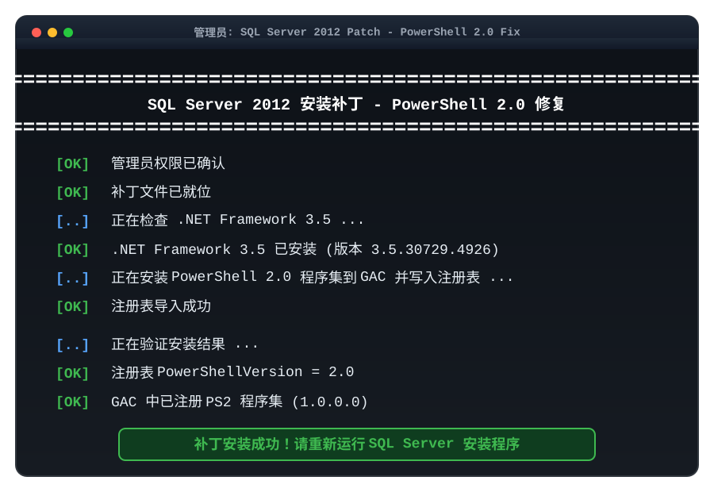
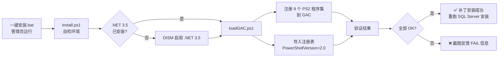

<p align="center">
  
</p>

<div align="center">

# 🔧「小明」SQL Server 2012 安装补丁 (PowerShell 2.0 修复)

**专为在新版 Windows 上安装老版 SQL Server 打造的 PowerShell 2.0 缺失修复工具箱**  
*源自微软官方缓解包 · 一键修复报错 · 绿色纯净可审计 · 图文齐全*

<p align="center">
  
  
  
  
  
  
</p>

<p align="center">
  <a href="#-运行效果演示">🎬 效果演示</a> •
  <a href="#-痛点与特性">💡 痛点解决</a> •
  <a href="#-快速上手">🚀 快速开始</a> •
  <a href="#-工作原理">🛠️ 工作原理</a> •
  <a href="#-目录结构">📂 目录结构</a> •
  <a href="#-如何移除">🧹 如何移除</a> •
  <a href="#-常见问题-faq">❓ 常见问题</a>
</p>

</div>

---

## 🎬 运行效果演示

<p align="center">
  
</p>

---

## 💡 痛点与特性

> **“装了新版 Windows，想装个老版 SQL Server 2008 R2 / 2012，结果卡在 PowerShell 2.0 报错，怎么都过不去……”**

在新版 Windows 上安装老版 SQL Server 时，最典型的一个坎就是 PowerShell 2.0 检查。本工具聚焦这个具体问题，一键解决：

| 典型痛点场景 | 本工具解决方案 |
| :--- | :--- |
| **安装时报「启用 Windows 功能 MicrosoftWindowsPowerShellV2 出错」** | 🔧 **一键注册 PS2 组件**：把 PowerShell 2.0 程序集注册进 GAC 并写入注册表，让安装程序检查直接通过 |
| **程序兼容性助手提示「此应用需要已弃用的 PowerShell 2.0」** | ✅ **注册表版本标记**：写入 `PowerShellVersion = 2.0`，彻底消除兼容性告警 |
| **手动启用 PowerShell 2.0 必然失败** | 🎯 **绕开系统功能开关**：不再走「启用 Windows 功能」这条死路，直接补齐安装程序要检测的底层组件 |
| **担心补丁不安全、来路不明** | 🛡️ **100% 微软官方来源**：全部内容取自微软支持页 KB5065506 提供的临时缓解包 ps2DLC，未做任何修改，可逐字节审计 |
| **装完想清理干净** | 🧹 **随时可逆移除**：删除对应注册表键即可，不影响系统自带的 PowerShell 3.0+ |

---

## 🌟 核心工程特色

1. **一键脚本，全自动诊断**：管理员权限自检 → .NET 3.5 依赖检测 → 自动导入 → 结果验证，四步闭环，全程彩色日志输出。
2. **多版本通用**：SQL Server 2008 R2 / 2012 / 2014 三版安装程序都依赖 PowerShell 2.0，本补丁全部适用。
3. **绿色纯净免安装**：不修改系统文件、不联网、不改启动项、无任何第三方代码，开箱即用。
4. **可逆可审计**：只做「注册 GAC 程序集 + 导入 2 个注册表项」两件事，附完整移除步骤。

---

## 🚀 快速上手

> 支持 Windows 10 / 11 操作系统（首次运行会自动弹出 UAC 请求管理员权限）。

### 三步搞定

**第 1 步** — 下载本仓库并解压到任意位置（路径尽量短，建议直接解压到 `D:\` 或 `E:\` 根目录）。

**第 2 步** — 右键点击 `一键安装.bat` → 选择「**以管理员身份运行**」，弹出 UAC 蓝色窗口时点「是」。

**第 3 步** — 看到绿色的 `补丁安装成功` 字样即完成，重新运行 SQL Server 安装程序即可正常安装。

### 克隆源码运行（推荐开发者）

```powershell
# 1. 克隆本仓库
git clone https://github.com/xm2284/sql-server-2012-ps2-fix.git
cd sql-server-2012-ps2-fix

# 2. 以管理员身份运行一键脚本
powershell -NoProfile -ExecutionPolicy Bypass -File ".\install.ps1"
```

> 或直接右键 `install.bat` → 「以管理员身份运行」。

### 前置条件：需要 .NET Framework 3.5

PowerShell 2.0 依赖 .NET 3.5 才能运行。绝大多数 Windows 默认已启用；若一键脚本提示缺少：

```
控制面板 → 程序 → 启用或关闭 Windows 功能
→ 勾选「.NET Framework 3.5（包括 .NET 2.0 和 3.0）」→ 确定
→ 重启电脑 → 再运行一次本补丁
```

> 一键脚本也会自动检测，并在你同意时尝试通过 DISM 启用。

---

## 🛠️ 工作原理

本补丁源自微软官方在支持页 **「PowerShell 2.0 removal from Windows」(KB5065506)** 中提供的临时缓解包 `ps2DLC.zip`，仅做两件事，让 SQL Server 安装程序的 PowerShell 2.0 检查通过：



**关键点**：

1. **为什么走不通官方「启用 Windows 功能」？** 微软已从 Windows 10 1709 起逐步移除 PowerShell 2.0，Windows 11 24H2/25H2 已彻底删除该组件。因此「启用 MicrosoftWindowsPowerShellV2」这条路径必然失败，只能直接补齐安装程序底层要检测的组件。
2. **注册到 GAC 的是哪个版本？** 是 `1.0.0.0` 的 PS2 程序集，与系统自带的 `3.0.0.0` 版本互不干扰，移除也不影响正常 PowerShell。
3. **写入哪些注册表？** `HKEY_LOCAL_MACHINE\SOFTWARE\Microsoft\PowerShell\1` 下的 `Install=1` 及 `PowerShellEngine\PowerShellVersion=2.0` 等键值。

---

## 📂 目录结构

```text
sql-server-2012-ps2-fix/
├── 一键安装.bat          # 双击入口（右键管理员运行）
├── install.bat           # 等价入口（英文标题栏）
├── install.ps1           # 主脚本：自检 / 依赖检测 / 导入 / 验证
├── 使用说明.txt          # 完整图文使用说明
├── assets/               # README 配图
│   ├── banner.svg
│   └── demo.svg
└── ps2DLC/               # 微软官方缓解包（未修改）
    ├── loadGAC.ps1       # 注册程序集到 GAC + 导入注册表
    ├── Binaries/         # amd64 / x86 两架构 PS2 程序集
    ├── ResourceBinaries/ # 各语言资源（含 zh-CN）
    └── regkeysNew/       # 2 个注册表文件
```

---

## ✅ 怎么确认装成功了

**方法一** — 看一键脚本输出，末尾显示：

```
[OK] 注册表 PowerShellVersion = 2.0
```

**方法二** — 手动检查注册表：

```
Win + R → 输入 regedit → 回车
定位到：HKEY_LOCAL_MACHINE\SOFTWARE\Microsoft\PowerShell\1\PowerShellEngine
右侧应存在一行：PowerShellVersion  值为  2.0
```

---

## 🧹 如何移除（可选）

补丁不影响系统正常使用，不移除也没关系。若想清理：

1. 以管理员身份运行 `regedit`，删除以下键：
   `HKEY_LOCAL_MACHINE\SOFTWARE\Microsoft\PowerShell\1`
2. 可选：卸载 GAC 中版本为 `1.0.0.0` 的 `System.Management.Automation`（这是 PS2 程序集，系统自带的 `3.0.0.0` 不受影响）。

> ⚠️ 移除后 SQL Server 安装程序的 PowerShell 2.0 检查会再次失败，建议等 SQL Server 完全装好后再考虑移除。

---

## ❓ 常见问题 FAQ

<details>
<summary><b>Q1. 运行后提示「找不到 .NET Framework 3.5」？</b></summary>

先按「前置条件」启用 .NET 3.5，再重新运行本补丁即可。
</details>

<details>
<summary><b>Q2. 提示执行策略限制，无法运行脚本？</b></summary>

一键脚本已自动绕过。手动方式请先执行：

```powershell
Set-ExecutionPolicy Bypass -Scope Process -Force
```
</details>

<details>
<summary><b>Q3. 双击没反应 / 没弹 UAC？</b></summary>

请确认是「右键 → 以管理员身份运行」，不是直接双击。
</details>

<details>
<summary><b>Q4. 装完 SQL Server 还是报别的错？</b></summary>

常见是缺 .NET 3.5 或有挂起的重启，先重启电脑再重试。仍失败可看安装日志：
`C:\Program Files\Microsoft SQL Server\110\Setup Bootstrap\Log`
</details>

<details>
<summary><b>Q5. 我装的是 SQL Server 2008 R2 / 2014，能用吗？</b></summary>

能。这三版安装程序都依赖 PowerShell 2.0，本补丁通用。
</details>

---

## 📝 关于作者与许可

> 作者：**小明同学鸭** · 本项目已在本机实测通过：安装 SQL Server 2012 SP1 Enterprise 成功，数据库引擎、Analysis Services、Reporting Services、SSMS 均正常。

本项目内容全部源自微软官方缓解包（KB5065506），仅做打包整理与使用说明，许可协议为 **MIT**。

---

<p align="center">
  <b>⭐ 如果这个工具帮你解决了 SQL Server 安装的坑，欢迎点个 <a href="https://github.com/xm2284/sql-server-2012-ps2-fix">Star</a> 支持一下～</b>
</p>
